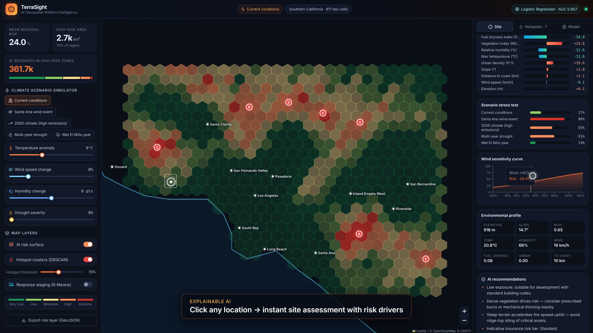

# 🔥 TerraSight — AI Geospatial Wildfire Intelligence

**🌐 Live demo: https://terrasight-aas-7dc5.vercel.app**



TerraSight is a full-stack AI platform that predicts **wildfire risk across Southern California** on an
interactive map. It combines machine learning, spatial analytics and climate scenario simulation in a
dark, "mission-control" dashboard.

**Stack:** React 18 + Vite + Leaflet + Recharts (frontend) · FastAPI + scikit-learn + NumPy (backend)

---

## ✨ Features

| Feature | What it does | ML / GIS technique |
|---|---|---|
| **AI risk surface** | Scores ~19,000 km² on a hexagonal grid (611 cells) and shows a live choropleth | Classifier trained on 10k+ labelled locations |
| **Model leaderboard** | Benchmarks 3 models on held-out data and serves the best one | Logistic Regression · Random Forest · Gradient Boosting with monotonic constraints |
| **Climate scenario simulator** | Sliders and presets (Santa Ana winds, 2050 climate, drought, El Niño) re-run the model across the whole map in real time | What-if inference |
| **Hotspot detection** | Finds and ranks clusters of high-risk terrain | DBSCAN with haversine distance, adaptive threshold |
| **Response planning** | Picks the best staging sites for N fire-response units | Risk-weighted K-Means |
| **AI site assessment** | Click any point to get its risk score, percentile, what drives the score, a scenario stress test, a wind-sensitivity curve and recommendations | Occlusion-based explainability |
| **Explainability** | Shows which features drive risk across the region | Permutation importance |
| **Exposure KPIs** | Shows high-risk area, residents exposed and the shift versus today | Spatial aggregation |
| **Export** | Downloads the current risk layer as GeoJSON for QGIS or ArcGIS | — |

---

## 🚀 Quick start

### 1. Backend (Python 3.10+)
```bash
cd backend
python -m venv .venv
source .venv/bin/activate        # Windows: .venv\Scripts\activate
pip install -r requirements.txt
uvicorn app.main:app --reload --port 8000
```
The models train automatically at startup, which takes about 5 seconds.
API docs: http://localhost:8000/docs

### 2. Frontend (Node 18+)
```bash
cd frontend
npm install
npm run dev
```
Open **http://localhost:5173**. Vite forwards `/api` requests to port 8000.

### Single-server mode (for demos and deployment)
```bash
cd frontend && npm run build      # creates frontend/dist
cd ../backend && uvicorn app.main:app --port 8000
```
FastAPI serves the built app at **http://localhost:8000**.

### Docker
```bash
docker build -t terrasight .
docker run -p 8000:8000 terrasight
```

---

## 🔌 API

| Method | Endpoint | Description |
|---|---|---|
| GET | `/api/health` | Status and model readiness |
| GET | `/api/meta` | Region, risk bands, scenario presets, places |
| GET | `/api/model` | Leaderboard, feature importance, training info |
| GET | `/api/grid` | GeoJSON hex grid with risk for each cell |
| GET | `/api/stats` | KPIs, risk-band counts, histogram |
| GET | `/api/hotspots?threshold=0.55` | DBSCAN hotspot zones |
| GET | `/api/resources?k=6` | Optimal response staging sites |
| POST | `/api/analyze` | Full assessment for one site (`{lat, lng, ...scenario}`) |

Every map endpoint also accepts these scenario parameters: `temp_delta` (°C), `wind_delta` (%), `humidity_delta` (pts), `drought` (0–1).

---

## 🧠 How the ML works

1. **Feature engineering** (`backend/app/geo.py`): each location gets 9 features: elevation, slope, NDVI vegetation index, max temperature, humidity, wind, fuel dryness, urban density and distance to the coast.
2. **Training data** (`backend/app/model.py`): about 14,000 land locations are sampled under randomised historical weather. Each one gets a 10-year burn outcome from a fire process with realistic behaviour: fuel load, dryness, and the interaction between Santa Ana winds and dry fuel.
3. **Model selection:** three classifiers are scored on AUC, accuracy and Brier score, and the best one is used.
4. **Inference and analytics:** the grid is scored for each scenario (results are cached), then clustered (DBSCAN) and optimised (K-Means).

### ⚠️ About the data
The project runs **fully offline** on a built-in synthetic environment model of Southern California, so it
needs no API keys or downloads. To make it production-grade, replace `environmental_features()` with real data
sources such as SRTM/USGS DEM (elevation), Sentinel-2 (NDVI), ERA5/gridMET (weather), WorldPop
(population), and train on real fire perimeters from CAL FIRE FRAP or NASA FIRMS. The API and the frontend
stay the same.

---

## 📁 Structure
```
terrasight/
├── backend/
│   ├── app/
│   │   ├── main.py      # FastAPI routes, hotspots, resources, site analysis
│   │   ├── model.py     # dataset, model benchmark, explainability
│   │   └── geo.py       # geospatial feature engine, hex grid, scenarios
│   └── requirements.txt
├── frontend/
│   ├── src/
│   │   ├── App.jsx
│   │   ├── api.js
│   │   ├── styles.css
│   │   └── components/  # MapView, ControlPanel, InsightPanel
│   └── vite.config.js
└── Dockerfile
```
